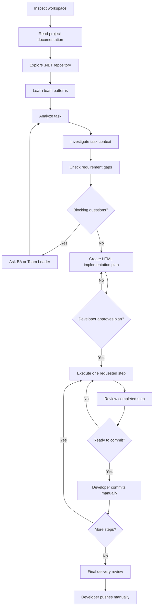

# OttoNet Skills

> Ship GitLab task to production-ready code. AI skills think like your team, code like your team.

Agent Skills that help .NET developers understand existing codebases, follow team conventions, and ship production-ready company tasks.

OttoNet is for .NET developers working on Business Analyst, Team Leader, or GitLab tasks in established company repositories. It reads the project before planning code, so implementation follows the repository architecture, local conventions, and team delivery style.

## Workflow



## Skills

| Stage | Skill | Role |
| --- | --- | --- |
| 1. Understand project | [dotnet-workspace-inspector](skills/dotnet-workspace-inspector/SKILL.md) | Inspect Git state and protect existing work before analysis. |
| 1. Understand project | [dotnet-project-documentation-reader](skills/dotnet-project-documentation-reader/SKILL.md) | Read repository docs, rules, setup notes, and AI instructions. |
| 1. Understand project | [dotnet-repository-explorer](skills/dotnet-repository-explorer/SKILL.md) | Map the .NET solution, projects, modules, and request flow. |
| 1. Understand project | [dotnet-team-pattern-learner](skills/dotnet-team-pattern-learner/SKILL.md) | Learn evidence-backed team coding patterns from existing work. |
| 2. Understand task | [dotnet-task-analyzer](skills/dotnet-task-analyzer/SKILL.md) | Extract requirements, rules, contracts, tests, and undefined details. |
| 2. Understand task | [dotnet-task-context-investigator](skills/dotnet-task-context-investigator/SKILL.md) | Inspect task-related code, relationships, and reference implementations. |
| 2. Understand task | [dotnet-requirement-gap-analyzer](skills/dotnet-requirement-gap-analyzer/SKILL.md) | Identify missing, ambiguous, conflicting, or blocked requirements. |
| 3. Plan | [dotnet-implementation-planner](skills/dotnet-implementation-planner/SKILL.md) | Create the approved step-by-step HTML implementation plan. |
| 4. Execute | [dotnet-step-executor](skills/dotnet-step-executor/SKILL.md) | Execute exactly one developer-requested plan step. |
| 5. Review | [dotnet-step-reviewer](skills/dotnet-step-reviewer/SKILL.md) | Review the completed step before the developer commits. |
| 6. Final delivery | [dotnet-final-delivery-reviewer](skills/dotnet-final-delivery-reviewer/SKILL.md) | Check full requirement coverage and readiness for manual push. |
| Orchestrate | [dotnet-company-task-orchestrator](skills/dotnet-company-task-orchestrator/SKILL.md) | Coordinate all skills while enforcing developer-controlled gates. |

## Usage

Keep this repository available to Codex as a skills source. In a cloned target .NET project on an existing feature branch, start with the orchestrator.

Example:

```text
Use dotnet-company-task-orchestrator to prepare a plan for
examples/certificate-management-task.md. Stop for clarification and plan approval;
do not implement code.
```

Templates are in [templates](templates). The sample task is [examples/certificate-management-task.md](examples/certificate-management-task.md).

## Safety

OttoNet does not clone, create or switch branches, reset, rebase, discard changes, merge, force-push, push, or run the whole plan automatically. The developer approves the plan, requests one step at a time, and commits manually.

## Author

Built by [Quoc Ba Huynh](https://github.com/quocbahuynh).

## Donate

If OttoNet helps you save time and ship better .NET tasks, you can support the project on [Buy Me a Coffee](https://buymeacoffee.com/quochb).
