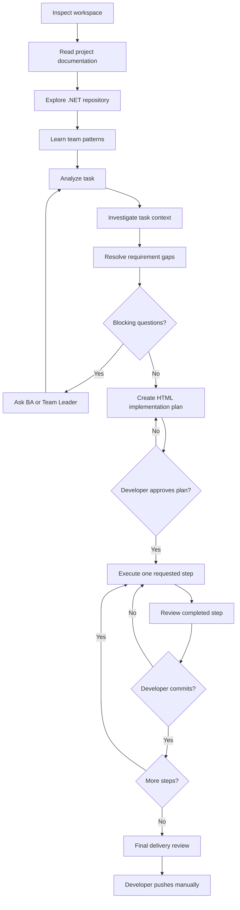

# OttoNet Skills

> Read. Learn. Ship.

Agent Skills that help .NET developers understand existing codebases, follow team conventions, and ship production-ready company tasks.

OttoNet is for .NET developers delivering Business Analyst, Team Leader, or GitLab tasks in established company repositories. It learns the project before planning code, so the work reflects the repository architecture, local conventions, and team delivery style.

## Install

This public repository is a skill source for the `skills` CLI; it is not an npm package. Install from GitHub with the commands below.

```bash
# Install the repository
npx skills add quocbahuynh/OttoNet-Skills

# Install every available skill
npx skills add quocbahuynh/OttoNet-Skills --skill '*'

# List available skills
npx skills add quocbahuynh/OttoNet-Skills --list

# Install one skill
npx skills add quocbahuynh/OttoNet-Skills \
  --skill dotnet-company-task-orchestrator

# Install all skills for Codex globally
npx skills add quocbahuynh/OttoNet-Skills \
  --skill '*' \
  --agent codex \
  --global
```

Use the options supported by your installed `skills` CLI and agent. No npm publishing or project package installation is required.

## Quick start

1. Open the root of an existing .NET project on the feature branch you intend to work on.
2. Install OttoNet for your agent, for example:

   ```bash
   npx skills add quocbahuynh/OttoNet-Skills --skill '*' --agent codex
   ```

3. Start a new agent task, then ask it to use the orchestrator with the BA, Team Leader, or GitLab task.
4. Review the generated HTML implementation plan and approve it before any code changes.
5. Request one plan step at a time, review it, and decide when to commit and push.

## Workflow



## Skills

| Skill | Purpose | Typical usage |
| --- | --- | --- |
| [dotnet-workspace-inspector](skills/dotnet-workspace-inspector/SKILL.md) | Protect the current Git workspace before analysis or implementation. | Inspect the target project before work begins or a requested step starts. |
| [dotnet-project-documentation-reader](skills/dotnet-project-documentation-reader/SKILL.md) | Extract repository rules, guidance, and operating instructions. | Read project documentation before the task. |
| [dotnet-repository-explorer](skills/dotnet-repository-explorer/SKILL.md) | Map the solution, modules, dependencies, and request flow. | Build project understanding from the existing codebase. |
| [dotnet-team-pattern-learner](skills/dotnet-team-pattern-learner/SKILL.md) | Identify evidence-backed coding conventions and classify their strength. | Study active code, history, and review evidence. |
| [dotnet-task-analyzer](skills/dotnet-task-analyzer/SKILL.md) | Preserve and structure a BA or Team Leader task without inventing behavior. | Extract requirements, contracts, rules, and unknowns. |
| [dotnet-task-context-investigator](skills/dotnet-task-context-investigator/SKILL.md) | Find task-related code, relationships, and reusable references. | Investigate a task’s domain and related modules. |
| [dotnet-requirement-gap-analyzer](skills/dotnet-requirement-gap-analyzer/SKILL.md) | Expose missing, ambiguous, conflicting, or blocked requirements. | Decide whether the task is ready for planning. |
| [dotnet-implementation-planner](skills/dotnet-implementation-planner/SKILL.md) | Produce a small-step HTML implementation plan. | Plan a fully clarified task for developer approval. |
| [dotnet-step-executor](skills/dotnet-step-executor/SKILL.md) | Implement exactly one approved plan step. | Execute a specifically requested step only. |
| [dotnet-step-reviewer](skills/dotnet-step-reviewer/SKILL.md) | Review one completed step before commit. | Check scope, requirements, validation, and consistency. |
| [dotnet-final-delivery-reviewer](skills/dotnet-final-delivery-reviewer/SKILL.md) | Review complete delivery readiness. | Verify the branch before a manual push. |
| [dotnet-company-task-orchestrator](skills/dotnet-company-task-orchestrator/SKILL.md) | Coordinate the workflow while enforcing developer-controlled gates. | Manage a GitLab task from inspection to final review. |

## Use OttoNet

In a cloned target .NET project on an existing feature branch, start with the skill that matches the current stage:

```text
Use dotnet-project-documentation-reader to understand this repository before reading the task.
```

```text
Use dotnet-team-pattern-learner to study completed implementations and identify the team's coding conventions.
```

```text
Use dotnet-company-task-orchestrator for this GitLab task, but stop at every required developer-controlled gate.
```

Supported agents can also select a skill automatically from its frontmatter `description`. Use the orchestrator when the full controlled workflow is needed. See [templates](templates) and the [Certificate Management example](examples/certificate-management-task.md).

## Safety boundaries

OttoNet never automatically clones repositories, creates or switches branches, resets or discards local changes, commits unless explicitly requested, pushes, merges, executes an entire plan without approval, or continues through unresolved business ambiguity. The developer approves the plan, requests one step at a time, and decides when to commit and push.

## Project status

Initial public release: 12 .NET company-task skills, shared report templates, an HTML plan template, and a realistic example task are available. Run `python3 scripts/validate-skills.py` to validate the repository skill metadata.

## Recommended GitHub topics

`agent-skills` · `dotnet` · `codex` · `claude-code` · `developer-tools` · `gitlab` · `software-engineering`

## License

Released under the [MIT License](LICENSE).

## Author

Built by [Quoc Ba Huynh](https://github.com/quocbahuynh).

## Donate

If OttoNet helps you save time and ship better .NET tasks, you can support the project on [Buy Me a Coffee](https://buymeacoffee.com/quochb).
