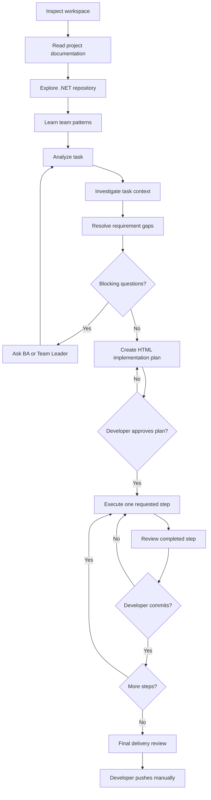

# OttoNet Skills

> Ship GitLab tasks to production-ready code. AI skills think like your team, code like your team.

OttoNet is a collection of Agent Skills for .NET teams that need to deliver Business Analyst, Team Leader, and GitLab tasks inside existing company codebases. It starts with evidence-based project understanding, then moves into implementation only after the repository architecture, conventions, and delivery practices are clear.

## Get started

From the root of an existing .NET project on the feature branch you intend to work on:

```bash
npx skills add quocbahuynh/OttoNet-Skills --skill '*' --agent codex
```

Start a new agent task with the BA, Team Leader, or GitLab requirement, then use this prompt:

```text
Use dotnet-company-task-orchestrator for this GitLab task, but stop at every required developer-controlled gate.
```

OttoNet first learns the repository, then creates an HTML implementation plan for approval. After approval, it executes and reviews only the single step the developer requests.

### Choose an operating mode

The orchestrator chooses the least costly mode that is still safe. The developer may request a stricter mode at any time.

| Mode | Use for | Evidence and investigation depth |
| --- | --- | --- |
| `FAST` | A narrow, low-risk fix in a well-understood area. | Reuse a current dossier, inspect the workspace, then verify only task-related documentation, files, and patterns. |
| `STANDARD` | The normal feature, API, or business-rule task. | Build or refresh the project map, team patterns, task context, and requirement decisions. |
| `STRICT` | New modules, migrations, authorization, external integrations, sensitive domains, or unclear architecture. | Use Standard coverage plus wider dependency tracing, stronger evidence, and proportionate extra validation. |

`FAST` never bypasses workspace protection, task clarification, plan approval, one-step execution, review, commit, or final-delivery gates. It is unavailable when the dossier is stale, requirements are ambiguous, or the task affects high-risk areas.

### Resume safely with workflow memory

For a multi-step task, the orchestrator creates a **task dossier** at `.ottonet/tasks/<task-slug>/`. Its canonical state file is `workflow-state.md`; it indexes the requirement report, architecture and pattern reports, evidence registry, context and gap reports, approved plan, and step reports. It records the current gate, resolved decisions, approved plan, step/review/commit status, source fingerprints, and a short append-only handoff log.

The dossier is a local sidecar by default: OttoNet does not stage, commit, push, delete, or add it to ignore rules. Teams that require task artifacts in version control can explicitly choose a repository-tracked location. Reports should reference evidence IDs and record only conclusions or changes since the last run; they should reuse current evidence when the source fingerprint is unchanged.

## Workflow



## Skills

| Skill | Purpose | Typical usage |
| --- | --- | --- |
| [dotnet-workspace-inspector](skills/dotnet-workspace-inspector/SKILL.md) | Protect the current Git workspace before analysis or implementation. | Inspect the target project before work begins or a requested step starts. |
| [dotnet-project-documentation-reader](skills/dotnet-project-documentation-reader/SKILL.md) | Extract repository rules, guidance, and operating instructions. | Read project documentation before the task. |
| [dotnet-repository-explorer](skills/dotnet-repository-explorer/SKILL.md) | Map the solution, modules, dependencies, and request flow. | Build project understanding from the existing codebase. |
| [dotnet-team-pattern-learner](skills/dotnet-team-pattern-learner/SKILL.md) | Identify evidence-backed coding conventions and classify their strength. | Study active code, history, and review evidence. |
| [dotnet-task-analyzer](skills/dotnet-task-analyzer/SKILL.md) | Preserve and structure a BA or Team Leader task without inventing behavior. | Extract requirements, contracts, rules, and unknowns. |
| [dotnet-task-context-investigator](skills/dotnet-task-context-investigator/SKILL.md) | Find task-related code, relationships, and reusable references. | Investigate a task’s domain and related modules. |
| [dotnet-requirement-gap-analyzer](skills/dotnet-requirement-gap-analyzer/SKILL.md) | Expose missing, ambiguous, conflicting, or blocked requirements. | Decide whether the task is ready for planning. |
| [dotnet-implementation-planner](skills/dotnet-implementation-planner/SKILL.md) | Produce a small-step HTML implementation plan. | Plan a fully clarified task for developer approval. |
| [dotnet-step-executor](skills/dotnet-step-executor/SKILL.md) | Implement exactly one approved plan step. | Execute a specifically requested step only. |
| [dotnet-step-reviewer](skills/dotnet-step-reviewer/SKILL.md) | Review one completed step before commit. | Check scope, requirements, validation, and consistency. |
| [dotnet-final-delivery-reviewer](skills/dotnet-final-delivery-reviewer/SKILL.md) | Review complete delivery readiness. | Verify the branch before a manual push. |
| [dotnet-company-task-orchestrator](skills/dotnet-company-task-orchestrator/SKILL.md) | Coordinate the workflow while enforcing developer-controlled gates. | Manage a GitLab task from inspection to final review. |

## Installation

OttoNet is distributed directly from this public GitHub repository through the `skills` CLI; no npm package or project dependency is required.

```bash
# Add the repository and choose skills interactively
npx skills add quocbahuynh/OttoNet-Skills

# List available skills without installing
npx skills add quocbahuynh/OttoNet-Skills --list

# Install the orchestrator only
npx skills add quocbahuynh/OttoNet-Skills \
  --skill dotnet-company-task-orchestrator

# Install every skill for Codex globally
npx skills add quocbahuynh/OttoNet-Skills \
  --skill '*' \
  --agent codex \
  --global
```

Use the flags supported by your installed `skills` CLI and target agent.

## Supported AI agents

OttoNet uses the portable Agent Skills format: each skill is a `SKILL.md` file with `name` and `description` frontmatter. It does not depend on vendor-specific hooks or metadata.

Common `skills` CLI targets include:

| Agent | `--agent` value |
| --- | --- |
| Codex | `codex` |
| Claude Code | `claude-code` |
| Cursor | `cursor` |
| Cline | `cline` |
| Gemini CLI | `gemini-cli` |
| GitHub Copilot | `github-copilot` |
| Kiro CLI | `kiro-cli` |
| OpenCode | `opencode` |
| OpenHands | `openhands` |
| Roo Code | `roo` |
| Windsurf | `windsurf` |

For example, install all OttoNet skills for Claude Code in the current project:

```bash
npx skills add quocbahuynh/OttoNet-Skills --skill '*' --agent claude-code
```

The [skills CLI supported-agent list](https://github.com/vercel-labs/skills#supported-agents) is the source of truth for the current full target list. Core OttoNet instructions are portable, while tool access, discovery behavior, and advanced capabilities remain agent-specific.

## Example prompts

```text
Use dotnet-project-documentation-reader to understand this repository before reading the task.
```

```text
Use dotnet-team-pattern-learner to study completed implementations and identify the team's coding conventions.
```

```text
Read the approved implementation plan and execute Step 3 only.
```

Supported agents can select skills from the frontmatter description. Use `dotnet-company-task-orchestrator` when the full gated workflow is required.

## Safety model

OttoNet never automatically:

- Clones repositories, creates or switches branches, resets changes, or discards local work.
- Commits unless explicitly instructed, pushes, or merges.
- Executes an entire implementation plan without developer approval.
- Continues when a business requirement remains unresolved.

The developer remains accountable for plan approval, step selection, commits, and pushes.

## Author and support

Built by [Quoc Ba Huynh](https://github.com/quocbahuynh). If OttoNet helps you save time and ship better .NET tasks, you can support the project on [Buy Me a Coffee](https://buymeacoffee.com/quochb).
