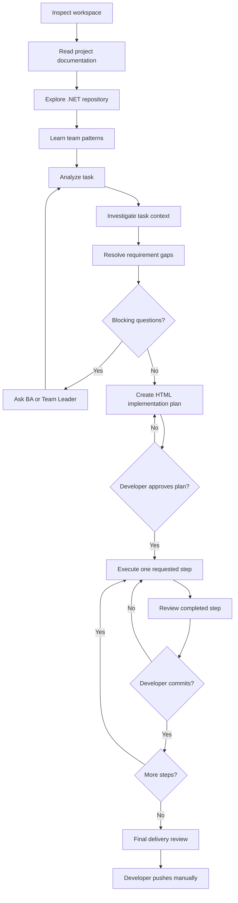

# OttoNet Skills

> Read. Learn. Ship.

Agent Skills that help .NET developers understand existing codebases, follow team conventions, and ship production-ready company tasks.

## Start here

OttoNet is for .NET developers working on Business Analyst, Team Leader, or GitLab tasks in an established company repository. It learns the project before planning code, so the work follows the repository architecture, local conventions, and team delivery style.

Use OttoNet when you want an agent to understand the codebase, surface missing business decisions, and implement only the step you explicitly request. You remain in control of approval, commits, and pushes.

## Start in 60 seconds

From the root of an existing .NET project on your feature branch:

```bash
npx skills add quocbahuynh/OttoNet-Skills --skill '*' --agent codex
```

Then start a new agent task with:

```text
Use dotnet-company-task-orchestrator for this GitLab task, but stop at every required developer-controlled gate.
```

The agent inspects and learns first, creates an HTML plan for approval, then performs one requested step at a time.

## Workflow



## Skills

| Skill | Purpose | Typical usage |
| --- | --- | --- |
| [dotnet-workspace-inspector](skills/dotnet-workspace-inspector/SKILL.md) | Protect the current Git workspace before analysis or implementation. | Inspect the target project before work begins or a requested step starts. |
| [dotnet-project-documentation-reader](skills/dotnet-project-documentation-reader/SKILL.md) | Extract repository rules, guidance, and operating instructions. | Read project documentation before the task. |
| [dotnet-repository-explorer](skills/dotnet-repository-explorer/SKILL.md) | Map the solution, modules, dependencies, and request flow. | Build project understanding from the existing codebase. |
| [dotnet-team-pattern-learner](skills/dotnet-team-pattern-learner/SKILL.md) | Identify evidence-backed coding conventions and classify their strength. | Study active code, history, and review evidence. |
| [dotnet-task-analyzer](skills/dotnet-task-analyzer/SKILL.md) | Preserve and structure a BA or Team Leader task without inventing behavior. | Extract requirements, contracts, rules, and unknowns. |
| [dotnet-task-context-investigator](skills/dotnet-task-context-investigator/SKILL.md) | Find task-related code, relationships, and reusable references. | Investigate a task’s domain and related modules. |
| [dotnet-requirement-gap-analyzer](skills/dotnet-requirement-gap-analyzer/SKILL.md) | Expose missing, ambiguous, conflicting, or blocked requirements. | Decide whether the task is ready for planning. |
| [dotnet-implementation-planner](skills/dotnet-implementation-planner/SKILL.md) | Produce a small-step HTML implementation plan. | Plan a fully clarified task for developer approval. |
| [dotnet-step-executor](skills/dotnet-step-executor/SKILL.md) | Implement exactly one approved plan step. | Execute a specifically requested step only. |
| [dotnet-step-reviewer](skills/dotnet-step-reviewer/SKILL.md) | Review one completed step before commit. | Check scope, requirements, validation, and consistency. |
| [dotnet-final-delivery-reviewer](skills/dotnet-final-delivery-reviewer/SKILL.md) | Review complete delivery readiness. | Verify the branch before a manual push. |
| [dotnet-company-task-orchestrator](skills/dotnet-company-task-orchestrator/SKILL.md) | Coordinate the workflow while enforcing developer-controlled gates. | Manage a GitLab task from inspection to final review. |

## Installation options

This public repository is a source for the `skills` CLI; it is not an npm package. Use the options supported by your installed CLI and agent.

```bash
# Add the repository interactively
npx skills add quocbahuynh/OttoNet-Skills

# View available skills without installing
npx skills add quocbahuynh/OttoNet-Skills --list

# Install one skill
npx skills add quocbahuynh/OttoNet-Skills \
  --skill dotnet-company-task-orchestrator

# Install every skill for Codex globally
npx skills add quocbahuynh/OttoNet-Skills \
  --skill '*' \
  --agent codex \
  --global
```

## Supported AI agents

OttoNet uses portable Agent Skills (`SKILL.md` with `name` and `description`) and does not require agent-specific hooks or metadata. Install it for any supported `skills` CLI target; common targets are:

| Agent | `--agent` value |
| --- | --- |
| Codex | `codex` |
| Claude Code | `claude-code` |
| Cursor | `cursor` |
| Cline | `cline` |
| Gemini CLI | `gemini-cli` |
| GitHub Copilot | `github-copilot` |
| Kiro CLI | `kiro-cli` |
| OpenCode | `opencode` |
| OpenHands | `openhands` |
| Roo Code | `roo` |
| Windsurf | `windsurf` |

For example, install all OttoNet skills for Claude Code in the current project:

```bash
npx skills add quocbahuynh/OttoNet-Skills --skill '*' --agent claude-code
```

See the [`skills` CLI supported-agent list](https://github.com/vercel-labs/skills#supported-agents) for the current full set of targets. Core skill instructions are portable, but each agent still controls its own tool access, discovery behavior, and feature support.

## Prompt examples

```text
Use dotnet-project-documentation-reader to understand this repository before reading the task.
```

```text
Use dotnet-team-pattern-learner to study completed implementations and identify the team's coding conventions.
```

```text
Read the approved implementation plan and execute Step 3 only.
```

Supported agents can select a skill from its frontmatter `description`; use the orchestrator when the full controlled workflow is needed.

## Safety boundaries

OttoNet never automatically:

- Clones repositories, creates or switches branches, resets or discards local changes.
- Commits unless explicitly requested, pushes, or merges.
- Executes an entire implementation plan without approval.
- Continues through unresolved business ambiguity.

The developer approves the plan, requests one step at a time, and decides when to commit and push.

## Resources

- [Templates](templates) for reports and standalone HTML implementation plans.
- [Certificate Management example](examples/certificate-management-task.md) for a realistic task.
- `python3 scripts/validate-skills.py` to validate repository skill metadata.
- [MIT License](LICENSE).

## Project status

Initial public release: 12 .NET company-task skills, shared report templates, an HTML plan template, and a realistic example task.

## Recommended GitHub topics

`agent-skills` · `dotnet` · `codex` · `claude-code` · `developer-tools` · `gitlab` · `software-engineering`

## Author and support

Built by [Quoc Ba Huynh](https://github.com/quocbahuynh). If OttoNet helps you save time and ship better .NET tasks, you can support the project on [Buy Me a Coffee](https://buymeacoffee.com/quochb).
