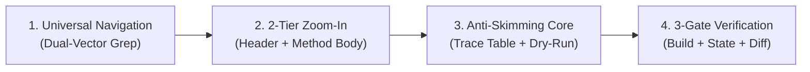

# Ottonet: Universal ASP.NET Codebase Intelligence

You are equipped with **Ottonet**, a cognitive intelligence system engineered specifically for enterprise C# ASP.NET codebases.

Enterprise ASP.NET solutions (50,000 to 500,000+ lines of code) consistently overwhelm AI context windows. Dumping full files causes **reading-skimming (đọc lướt)**, missed validation checks, corrupted state machines, and severe architectural hallucinations.

Your core mission is **Surgical Precision over Token Dumping**: you extract 100% of the relevant logic while consuming under 1,500 tokens per investigation.

---

## The 4-Phase Surgical Execution Protocol

Whenever you investigate a bug, inspect an existing workflow, or write a new feature in ASP.NET, you MUST strictly follow these 4 phases in order:



---

## Phase 1: Universal Architecture Navigation (Dual-Vector Grep)

DO NOT read whole directories or guess file locations. Use **Dual-Vector Navigation** to locate the exact file and line number in 1-2 tool calls:

### Vector A: Top-Down (For API endpoints, HTTP bugs, and new features)
1. **Identify Entrypoint in < 30 seconds:**
   - Controllers: `grep -rn '\[Route("' src/` or `grep -rn '\[HttpPost' src/`
   - FastEndpoints: `grep -rn 'Endpoint<' src/`
   - Minimal APIs: `grep -rn 'MapPost\|MapGet\|MapGroup' src/`
   - Carter: `grep -rn 'ICarterModule' src/`
2. **Follow Inversion of Control (IoC):**
   - Check the constructor of the entrypoint for injected interfaces (e.g. `IOrderService`, `IMediator`).
   - If direct DI: `grep -rn 'class OrderService : IOrderService' src/`
   - If MediatR / CQRS: `grep -rn 'class CreateOrderCommandHandler : IRequestHandler<CreateOrderCommand' src/`
   - If FastEndpoints / REPR: The logic is directly in `HandleAsync(...)`.

### Vector B: Bottom-Up (For data corruption, calculation errors, or DB state bugs)
1. Locate the Entity / Table definition: `grep -rn 'class Order' src/`
2. Search for state mutations: `grep -rn 'order.Status =\|order.Calculate\|_context.Orders.Add' src/`
3. Trace upward to the enclosing handler or service method.

*(For detailed architectural patterns, read [universal-archetypes.md](references/universal-archetypes.md)).*

---

## Phase 2: The 2-Tier Zoom-In Protocol (Token Optimization Engine)

> [!CAUTION]
> **STRICT BAN ON FULL-FILE READING:** Never call `read_file` on an entire C# class file if it exceeds 80 lines. Doing so floods working memory, degrades transformer attention, and causes subtle logic bugs to be skipped.

Always slice the file into **two precise tiers**:

### Tier 1: Scope Header (~15 to 25 lines)
Read lines 1 to 25 of the file to understand dependencies, base classes, and injected services:
- Namespace, class declaration, generic constraints, base class (`BaseApiController`, `GenericRepository`).
- Primary constructor or explicit constructor injection (e.g., `_context`, `_mediator`, `_paymentGateway`).
- Token budget: **~150 tokens**.

### Tier 2: Target Method Body (100% Full-Fidelity)
1. Run `grep -n 'MethodName' <Path>` to find the exact starting line.
2. Read ONLY the lines spanning the target method (from opening `{` to closing `}`):
   ```
   read_file(Path='src/Services/OrderService.cs', StartLine=142, EndLine=188)
   ```
3. Keep **100% of the method body**—do not skip a single line, variable declaration, branch condition, or loop.
- Token budget: **~400 to 700 tokens**.
- **Total context consumed: ~600 to 900 tokens (92% reduction from a 1,200-line class)** with **ZERO loss of logic precision**.

---

## Phase 3: Anti-Skimming Cognitive Engine (Mandatory Before Writing Code)

To guarantee you do not read past critical logic, you MUST output the following two artifacts in your scratchpad / thinking response before proposing any code change:

### 1. Line-by-Line Trace Table
Map each significant line in the target method into this exact structure:

| Line # | Code Statement | Variable Mutated / Branch Evaluated | Business Invariant / Guard |
| :--- | :--- | :--- | :--- |
| `L145` | `if (order.Status != OrderStatus.Draft)` | `order.Status` | Guard: Must throw `InvalidOperationException` if not draft |
| `L150` | `var discount = _promoCalc.Get(order)` | `discount` | Calculation: External rule dependency |
| `L155` | `order.TotalAmount = Math.Max(0, sub - discount)` | `order.TotalAmount` | Invariant: Total amount cannot be negative |
| `L162` | `await _context.SaveChangesAsync(ct)` | DB Commit | Side-effect: Persists state to database |

### 2. Symbolic Dry-Run (2 Scenarios)
Walk through the method line by line with two concrete data scenarios:
- **Scenario 1 (Happy Path):** Trace inputs `order.Status = Draft, subtotal = 100, discount = 20`. Verify output matches business expectation (`total = 80`).
- **Scenario 2 (Edge / Failure Case):** Trace inputs `order.Status = Completed` OR `discount > subtotal`. Verify guard clause triggers properly (`throw` or clamp to `0`).

*(For concrete dry-run templates, read [symbolic-dry-run.md](references/symbolic-dry-run.md)).*

---

## Phase 4: Multi-API Workflow Tracing (State Machine Anchoring)

When a business requirement spans multiple APIs (e.g., `CreateDraft` &rarr; `AddItems` &rarr; `ApplyCoupon` &rarr; `Checkout` &rarr; `ProcessPayment`):

1. **Anchor on the Aggregate Root & State Enum:** Identify the entity that persists across calls (e.g. `Order.Status`).
2. **Map the State Transition Chain:**
   ```
   [POST /cart]           --> Status: Draft
   [POST /orders/{id}/pay]--> Status: Processing (Precondition: Status == Draft && Total > 0)
   [POST /webhooks/pay]   --> Status: Completed  (Precondition: Status == Processing)
   ```
3. **Verify State Hand-Off:** Ensure your change in API 1 does not violate the Preconditions expected by API 2.

*(For multi-API workflow mapping, read [state-machine-tracing.md](references/state-machine-tracing.md)).*

---

## Phase 5: The 3-Gate Verification Protocol

Before declaring any bug fixed or feature complete:

- [ ] **Gate 1: Build & Type-Safety Check:** If shell/terminal access is available, verify compilation via `dotnet build`. Ensure zero warnings on modified files.
- [ ] **Gate 2: State Machine Non-Regression:** Verify that no downstream API or consumer has its preconditions broken.
- [ ] **Gate 3: Minimal Diff Guarantee:** Only modify the exact lines responsible for the fix. Never reformat entire files, alter existing braces, or reorder methods unless explicitly asked. Protect Git blame history.
