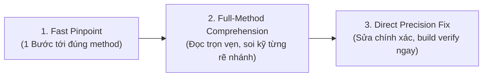

# Ottonet: Universal ASP.NET Codebase Intelligence

**Mục tiêu tối thượng: CHÍNH XÁC 100% & PHẢN HỒI NHANH NHẤT.**

Khi làm việc với các giải pháp C# ASP.NET quy mô lớn (50.000 đến 500.000+ dòng code), thách thức lớn nhất của AI là: **đọc lướt (skimming) dẫn đến hiểu sai logic nghiệp vụ, đoán mò khi gặp Inversion of Control (IoC/DI/MediatR), và tốn quá nhiều lượt gọi công cụ rườm rà.**

Ottonet loại bỏ hoàn toàn các bước thủ tục rườm rà, tập trung vào **2 nguyên tắc cốt tử**:
1. **Tìm đúng nơi trong 1 bước duy nhất (Blazing-Fast Traversal)**.
2. **Đọc thấu đáo 100% chi tiết logic, tuyệt đối không đoán mò (Zero-Skimming Rigor)**.

---

## Quy Trình 3 Bước: Nhanh Nhất & Chính Xác Nhất

---

## Bước 1: Định Vị Nhanh Điểm Nóng (Fast Pinpoint in 1 Step)

Không duyệt file thủ công, không đoán vị trí. Dùng ngay lệnh tìm kiếm chính xác nhất theo loại bài toán:

### 1. Nếu là Endpoint / API / Lỗi HTTP:
- **Controllers:** `grep -rn '\[HttpGet\|\[HttpPost\|\[HttpPut\|\[HttpDelete' src/` hoặc `grep -rn '"api/path"' src/`
- **FastEndpoints:** `grep -rn 'Endpoint<.*Request' src/`
- **Minimal APIs:** `grep -rn 'MapPost\|MapGet\|MapGroup' src/`
- **Carter:** `grep -rn 'ICarterModule' src/`

### 2. Nếu là Xử Lý Nghiệp Vụ / Tính Toán / Service:
- Tìm thẳng tên method hoặc interface: `grep -rn 'CalculateTax\|ProcessOrder\|CancelInvoice' src/`
- **Nhảy IoC trong 1 bước:**
  - Nếu gặp `_mediator.Send(new CreateOrderCommand(...))` &rarr; grep ngay: `grep -rn 'IRequestHandler<CreateOrderCommand' src/`
  - Nếu gặp interface `IOrderService` &rarr; grep ngay: `grep -rn 'class OrderService : IOrderService' src/`

---

## Bước 2: Thấu Đáo 100% Logic (Zero-Skimming & Full Rigor)

> [!IMPORTANT]
> **NGUYÊN TẮC CHÍNH XÁC 100%:** Tuyệt đối không đoán trước logic của một method qua tên gọi của nó. Một method tên `CalculateDiscount` có thể chứa điều kiện VIP ngầm, giới hạn trần, hoặc thuế đặc thù mà nếu đọc lướt sẽ phá vỡ toàn bộ hệ thống.

1. **Đọc trọn vẹn ngữ cảnh cần thiết trong 1 lượt duy nhất:**
   - Đọc từ đầu method `{` đến cuối method `}` (kèm 15-20 dòng khai báo dependency/constructor của class).
   - Đọc đủ dài để có bức tranh hoàn chỉnh ngay lập tức, không đọc vụn vặt gây tốn nhiều round-trip.

2. **Soi kỹ 5 cái bẫy logic chết người của C#:**
   - **Toán tử so sánh:** `<` hay `<=`, `>` hay `>=` (đặc biệt trong phân trang, hạn mức, ngày hết hạn).
   - **Xử lý Null & Nullable:** `?.` và `??` có vô tình nuốt mất lỗi hoặc trả về giá trị mặc định sai không?
   - **Rẽ nhánh Enum / Switch:** Có trường hợp enum nào mới chưa được xử lý trong `switch expression` không?
   - **Kiểu dữ liệu tiền tệ / số học:** Phép tính dùng `decimal` hay `double`? Có bị làm tròn banker (`MidpointRounding.ToEven`) làm lệch 1 xu không?
   - **EF Core Change Tracking:** Entity đang sửa có đang được `DbContext` track không? Hay là detached entity cần gọi `_context.Update()`?

3. **Mô phỏng chạy thử nhẩm (Mental Dry-Run):**
   - Đưa dữ liệu mẫu vào và chạy nhẩm qua từng dòng `if-else`:
     - *Nếu input là 0 hoặc null thì dòng nào chạy?*
     - *Nếu điều kiện biên đạt cực đại thì logic có bị tràn không?*

---

## Bước 3: Xử Lý Workflow Nhiều API (Nếu Có)

Khi một nghiệp vụ lớn xâu chuỗi qua nhiều API (ví dụ: `Tạo đơn -> Giữ hàng -> Thanh toán -> Hoàn tất`):
- **Neo vào Vòng Đời Trạng Thái (Status Lifecycle):** Xác định enum trạng thái của Thực thể chính (`OrderStatus: Draft -> Reserved -> Paid -> Completed`).
- **Kiểm tra Preconditions:** Trước khi sửa code ở API hiện tại, đảm bảo không làm thay đổi định dạng dữ liệu hoặc trạng thái mà API tiếp theo trong workflow yêu cầu.

---

## Bước 4: Sửa Chính Xác & Xác Minh Tức Thì (Direct Precision Fix)

1. **Sửa trực diện (Minimal & Laser-Focused):**
   - Chỉ sửa đúng các dòng code gây lỗi.
   - Không tự ý reformat cả file, không đổi style code của team khác để bảo toàn `git blame`.
2. **Build Kiểm Tra Ngay (Nếu terminal khả dụng):**
   - Chạy `dotnet build` để đảm bảo 0 lỗi syntax, 0 lỗi type-safety trước khi kết luận.
