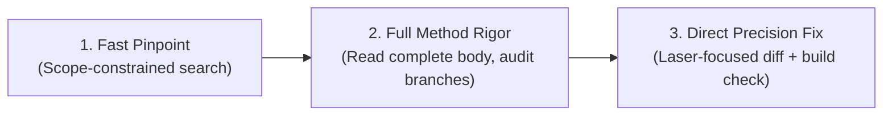

# Ottonet: Universal ASP.NET Codebase Intelligence

**Prime Objective: 100% ACCURACY & FASTEST INFERENCE SPEED.**

On large enterprise C# ASP.NET codebases (50,000 to 500,000+ lines of code), standard AI assistants fail because they **skim code, miss subtle business invariants, guess Inversion of Control (IoC/DI/MediatR) wiring, and waste round-trips**.

Ottonet eliminates procedural overhead and enforces two core disciplines:
1. **Pinpoint the exact implementation in a single step (Blazing-Fast Traversal).**
2. **Read complete method logic with full rigor—never assume or guess (Zero-Skimming Rigor).**

---

## 3-Step Execution Loop

---

## Step 1: Blazing-Fast Traversal & Scope-Constrained Search

Never browse directories or guess file locations. In solutions with dozens of projects, common method names (`Handle`, `Validate`, `Execute`, `GetById`) generate dozens of false positives.

### 1. Scope-Constrained Search (Eliminates 90% Noise)
- Always constrain your search to the specific bounded context or module folder:
  - Good: `grep -rn 'CalculateTax' src/Features/Billing/` or `grep -rn 'class OrderService' src/Services/`
  - Bad: `grep -rn 'CalculateTax' .` (scans irrelevant projects, builds, and tests)

### 2. HTTP Endpoint / API Routing
- **Controllers:** `grep -rn '\[HttpGet\|\[HttpPost\|\[HttpPut\|\[HttpDelete' src/` or `grep -rn '"api/path"' src/`
- **FastEndpoints:** `grep -rn 'Endpoint<.*Request' src/`
- **Minimal APIs:** `grep -rn 'MapPost\|MapGet\|MapGroup' src/`
- **Carter:** `grep -rn 'ICarterModule' src/`

### 3. Resolve IoC / Indirection in 1 Step
- If calling `_mediator.Send(new CreateOrderCommand(...))`: `grep -rn 'IRequestHandler<CreateOrderCommand' src/`
- If injecting interface `IOrderService`: `grep -rn 'class OrderService : IOrderService' src/`

---

## Step 2: Zero-Skimming & 100% Logic Rigor

> [!IMPORTANT]
> **100% ACCURACY MANDATE:** Never infer logic from a method name. A method named `CalculateDiscount` may contain hidden VIP conditions, ceiling caps, or tax rules that break if skimmed.

1. **Read complete method context in ONE tool call:**
   - Read from opening brace `{` to closing brace `}` (including the class constructor/dependencies).
   - Get the full picture immediately without micro-reading or multiple fragmented calls.

2. **Audit the 5 Fatal C# Logic Traps:**
   - **Boundary Comparisons:** `<` vs `<=`, `>` vs `>=` (especially in pagination, limits, expiration checks).
   - **Null Swallowing:** Do `?.` and `??` silently swallow critical errors or supply incorrect fallbacks?
   - **Enum Exhaustiveness:** Are all enum members handled in `switch` expressions without uncaught defaults?
   - **Financial Math:** Is `decimal` used instead of `double`? Does banker's rounding (`MidpointRounding.ToEven`) introduce 1-cent discrepancies?
   - **EF Core Change Tracking:** Is the entity attached and tracked by `DbContext`, or is it detached requiring explicit update?

3. **Audit Async & Concurrency Invariants:**
   - **Never run `Task.WhenAll` on the same `DbContext`:** Scoped `DbContext` is NOT thread-safe. Concurrent operations cause runtime crashes. Use `IDbContextFactory` if true parallelism is required.
   - **Always `await SaveChangesAsync(ct)`:** Never fire-and-forget database mutations.
   - **Propagate `CancellationToken`:** Pass `ct` from the HTTP action all the way down to database queries.
   - **No Database Queries in `foreach` Loops:** Avoid N+1 query traps. Batch fetch using `.Where(x => ids.Contains(x.Id))` before the loop.

4. **Mental Dry-Run:**
   - Trace concrete sample values through the branch logic:
     - *What happens when input is 0 or null?*
     - *What happens when boundary values are exceeded?*

---

## Step 3: Multi-API Workflow Tracing

When business logic spans multiple sequential APIs (`Create -> Reserve -> Pay -> Complete`):
- **Anchor on Aggregate Root Status Lifecycle:** Track the core enum (`OrderStatus: Draft -> Reserved -> Paid -> Completed`).
- **Verify Preconditions:** Modifying API $N$ must not invalidate preconditions expected by API $N+1$.

---

## Step 4: Direct Precision Fix

1. **Minimal Diff:** Modify only the necessary lines. Never reformat entire files or alter team code styles. Preserve Git blame.
2. **Build Verification:** Run `dotnet build` whenever terminal is available to ensure 0 syntax and type-safety errors.
