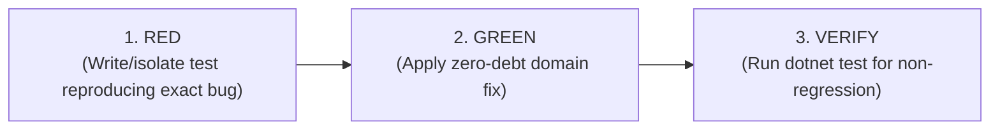

# Test-Driven Bug Reproduction & Verification Playbook

The ultimate proof of a business logic fix is **Test-Driven Verification (Red-to-Green)**. Proposing a fix without proving the defect leads to regressions and subtle edge-case failures.

---

## The 3-Step Red-to-Green Protocol



---

### Step 1: Isolate the Defect (The RED Test)

Locate the existing test project (`tests/`, `*.Tests/`, `*.UnitTests/`) and check existing test conventions (xUnit, NUnit, MSTest, FluentAssertions, Moq, NSubstitute).

Construct or identify a minimal unit test isolating the exact business failure reported:

```csharp
[Fact]
public void CalculateDiscount_WhenOrderTotalEqualsThreshold_ShouldApplyDiscount()
{
    // Arrange: Setup boundary input reported in bug (e.g. Total exactly $1000)
    var order = new Order(customerId: 123);
    order.AddItem(new OrderItem(productId: 1, unitPrice: 1000m, quantity: 1));
    var discountPolicy = new VipDiscountPolicy();

    // Act
    var discount = discountPolicy.Calculate(order);

    // Assert: Demonstrates the bug (Previously failed if code used '>' instead of '>=')
    discount.Should().Be(100m);
}
```

- Run the test:
  ```bash
  dotnet test --filter "FullyQualifiedName~CalculateDiscount"
  ```
- **Confirm RED:** The test MUST fail, proving that the test genuinely reproduces the reported defect.

---

### Step 2: Implement Zero-Debt Domain Fix (The GREEN Transition)

Apply the fix directly inside the Domain Entity, Value Object, or Domain Policy (never inside the API controller):

```csharp
// Domain/Policies/VipDiscountPolicy.cs
public decimal Calculate(Order order)
{
    // FIX: Changed strict '>' to inclusive '>=' according to business specification
    if (order.Subtotal >= Thresholds.VipMinimum)
    {
        return order.Subtotal * 0.10m;
    }
    return 0m;
}
```

---

### Step 3: Verify Zero Regression

1. **Rerun the Targeted Test:**
   ```bash
   dotnet test --filter "FullyQualifiedName~CalculateDiscount"
   ```
   - **Confirm GREEN:** The test now passes cleanly.

2. **Run Full Test Suite:**
   ```bash
   dotnet test
   ```
   - **Confirm ZERO REGRESSIONS:** Ensure all adjacent domain tests, validators, and integration tests remain green.
